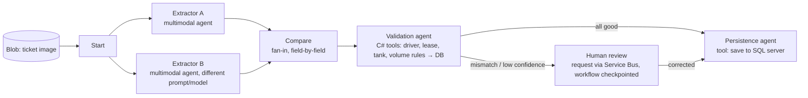

# Handoff: round 3 prep (current)

> **Final round done (2026-10-20, Jawad Malik CIO + Chuck); decision within a week.** Debrief in `~/RiderProjects/cs-coding-interview/companies/milbank-net-ai.md` under "Round 3 debrief". Earlier note: Prep in `~/RiderProjects/cs-coding-interview/companies/milbank-net-ai.md` under "Round 3 (final)". The user gets the CIO's LinkedIn on Monday: tailor it then. Agree salary/start date with Finlay before Tuesday.
>
> Round 2 (2026-10-13, Anna Yampolsky + David Katz) went well. The debrief with their questions is in `~/RiderProjects/cs-coding-interview/companies/milbank-net-ai.md` under "Round 2 debrief". Waiting on feedback from Finlay. Next: round 3 prep once we know who it's with; brush up on SPFx and Blazor, and have a project-ownership story ready.

# (Previous) round 2 prep

> First message for the new session: *"Read notes/handoff.md and continue from there."*

## Where things stand

- **Milbank, Senior AI/.NET Engineer.** Round 1 with Chuck Gilker (Director, Application Programming & Support) went well; I'm invited to round 2.
- **Round 2:** Tuesday 2026-10-13 or Wednesday 2026-10-14, 12:15 PM ET. **Prepare to be ready by Tuesday.** It's with **two of Chuck's developers**: C#, .NET, Blazor, Azure and AI app development. Expect deep, hands-on questions ("what's wrong with this code?", "how would you implement…?"), maybe live coding or a screen share.
- **`~/RiderProjects/cs-coding-interview/companies/milbank-net-ai.md`** is my review doc from round 1 (openers, the AI deep-dive with code, SQL tuning, Service Bus, SOAP, behavioral STAR stories, scenarios, questions to ask). Read it first so you don't repeat what's covered. Add round-2 material to it as **new sections**.
- The job description and my resume are summarized in `~/RiderProjects/cs-coding-interview/companies/milbank-net-ai.md` and in the earlier context below.

## Progress (2026-10-11)

Doing the **round-1 questions first** (they show what Milbank cares about; the questions are in `~/RiderProjects/cs-coding-interview/companies/milbank-net-ai.md` and the session notes), then the topics below.
1. ✅ ServiceNow RAG: Qdrant, ticket chunking, keys vs. hashes, the watermark, deletes, accuracy, hybrid/RRF → `~/RiderProjects/cs-coding-interview/companies/milbank-net-ai.md` §3.9–3.11
2. ✅ Agent Framework: why (§3.7), state (§3.12), how agents communicate / Service Bus (§3.13)
3. ✅ How to *test* that security trimming can't be bypassed (§3.5)
4. ✅ Choosing the tool (§3.14), where to deploy (§3.15), website chatbots (§3.16)
5. ✅ Troubleshooting mitigate-then-fix (§3.4), what I'd do differently (§3.17), HR (§7)

Topic 1 (C# and async) → `~/RiderProjects/cs-coding-interview/companies/milbank-net-ai.md` §4.8–4.9 (rewritten in the fuller format after feedback). Topic 2 (ASP.NET Core) → §4.10, fuller format (why + example + hook; user found the terse version hard). Quiz answers in §4.10. Also: groups-overage story (§4.10), Azure migration challenges (§4.11), code-review answer (§5). Topic 3 (Blazor) → §4.12 with quiz answers. Topic 5 (Azure) → §4.13; its quiz is pending. Round 2 is with Anna Yampolsky and David Katz (profiles summarized in the Milbank prep): SQL §4.14, legal systems / integration / governance §4.15, tailored questions in §8. Next: live-coding practice.

## Reference code (they may drill into it)

Treat these as work I've also done at Marathon; don't assume I haven't.
- `~/RiderProjects/agents-on-dotnet`: TicketIntake, an Agent Framework workflow (two extractors in parallel, compare, validate, save, review API). README has the design decisions.
- `~/RiderProjects/rag-on-dotnet`: RagChat (Microsoft.Extensions.AI, Azure AI Search hybrid search, Document Intelligence, ethical-wall security trimming, citations, evaluation harness). README + `docs/interview-prep.md`.
- `~/RiderProjects/microsoft-agent-framework-samples`: the official .NET samples, the source of truth for Agent Framework APIs.

## How we work

For each topic: likely questions → short, clear answers **with small code snippets** (before/after where it helps) → quiz me → once I say I'm happy, **document it in `~/RiderProjects/cs-coding-interview/companies/milbank-net-ai.md`**. Small steps; don't dump everything at once. Verify API claims against the installed packages/samples.

## Topics, in order

1. **C# and async:** `.Result`/`.Wait()`, `async void`, `Task` vs `ValueTask`, cancellation, `WhenAll` vs `Parallel.ForEachAsync`, `SemaphoreSlim` vs `lock`; LINQ deferred execution, multiple enumeration, `IEnumerable` vs `IQueryable`; records, nullable reference types, pattern matching, `IDisposable`/`await using`, class vs struct; a few features from .NET 8/9/10.
2. **ASP.NET Core:** DI lifetimes and captive dependencies, middleware order, minimal APIs vs controllers, the options pattern, `HttpClientFactory` and resilience, EF Core (tracking, N+1, `DbContext` thread safety), `BackgroundService`, health checks, auth (Entra ID, JWT, policies), testing (xUnit, `WebApplicationFactory`).
3. **Blazor:** render modes, lifecycle (prerendering runs `OnInitializedAsync` twice), parameters/`EventCallback`/cascading values, `StateHasChanged`, `EditForm` validation, Blazor Server circuits and `IDbContextFactory`, JS interop, streaming AI responses, virtualization for large grids.
4. **AI app development in code:** `IChatClient` and its middleware (`UseFunctionInvocation`, `UseOpenTelemetry`), streaming, the tool-calling loop step by step, structured output, embeddings and vector search, Agent Framework (agents vs workflows, executors, edges, state), context/token management, 429 handling, MCP, prompt injection.
5. **Azure:** Functions (triggers, bindings, isolated worker), Service Bus queues vs topics, Blob SAS vs managed identity, `DefaultAzureCredential`, App Insights/OpenTelemetry, deployment slots, Bicep, Azure DevOps YAML.
6. **Live coding practice:** with AI completion turned off; think out loud.

## Pending: document once I confirm

Answer already given for **"Is my human-in-the-loop different from the sample?"** (`03-workflows/HumanInTheLoop`):
- The sample is **in-workflow** HITL: a `RequestPort` emits a `RequestInfoEvent`; the caller answers with `SendResponseAsync` and the run continues. For long waits: checkpoint, dispose, restore (`03-workflows/Checkpoint/CheckpointWithHumanInTheLoop`).
- Mine: the review **ends the run**. `save` writes NeedsReview, the inbox is a DB query, the fix goes through the same `TicketRules`. No checkpoint store, deployments can't break in-flight runs, audit for free.
- Pick in-workflow for short, interactive approvals (approving a tool call in chat); mine for hours-long back-office review.
- Spoken version: "Agent Framework supports human-in-the-loop inside the workflow… for ticket review the reviewer might answer hours later, so I made the review end the run instead…"

---

# Earlier context (build sessions)

# Handoff: agents-on-dotnet

> One-time context for a new Claude Code session in `~/RiderProjects/agents-on-dotnet`. Standing rules are in `CLAUDE.md`.
>
> First message for the new session: *"Read notes/handoff.md and continue from there."*

## Why this exists

I'm interviewing for **Senior AI/.NET Engineer at Milbank (law firm)**, first round **Mon 2026-10-05, 12pm ET**, with Chuck Gilker (Director of Application Programming & Support). There will be 3 rounds. The job description emphasizes RAG, tool/function calling, context management, **agents and multi-step workflows (Microsoft Agent Framework, Semantic Kernel)**, Azure (Functions, Service Bus, Storage, Key Vault), evaluation, guardrails, and Responsible AI.

This repo is the hands-on twin of the **agent bullets on my resume**, so I can explain them in depth. Goal: **learn and implement them in the simplest, most elegant, best-practice way**. Good code is easy to read, reason about, and maintain.

### The resume bullets (verbatim)

1. *Designed a multi-agent workflow using Microsoft Agent Framework to automate driver run ticket entry, using two parallel multimodal extraction agents to read ticket images from Azure Blob Storage, a validation agent that calls C# tools to cross-check results and verify data against the database, human-in-the-loop review through Azure Service Bus for mismatches, and a persistence agent that writes validated data to SQL Server.*
2. *Built an autonomous troubleshooting agent using Microsoft Agent Framework that uses C# tools to monitor Serilog structured logs in SQL Server for critical errors, retrieves the relevant source file through the Azure DevOps API based on the stack trace, and passes only that targeted context to the model to recommend fixes for tier-1 failures, reducing on-call troubleshooting time.*

(Context: Marathon Petroleum, transportation logistics. A "run ticket" is the document a truck driver fills in for a crude oil pickup: ticket number, driver, lease/well, tank, gauge readings, volume (barrels), temperature, gravity (API), BS&W, date/time, signatures. It's often a photo or scan.)

## Decisions already made

- **Primary reference:** [microsoft/agent-framework .NET samples](https://github.com/microsoft/agent-framework/tree/main/dotnet/samples). Read these first and verify every API against the installed version (packages `Microsoft.Agents.AI*` were at **1.23.0** on 2026-10-04):
  - `03-workflows/_StartHere`, `Concurrent` (fan-out/fan-in), `HumanInTheLoop`, `Checkpoint`, `Agents`, `ConditionalEdges`, `SharedStates`, `Observability`, `Evaluation`
  - `05-end-to-end/DevUIAspireIntegration` (Aspire + DevUI to visualize and run workflows)
- **Secondary, ideas only:** [Azure-Samples/azure-ai-travel-agents](https://github.com/Azure-Samples/azure-ai-travel-agents). Take the orchestrator pattern, tools exposed as MCP servers, and observability. Don't copy its multi-language stack.
- **Build #1 (run-ticket workflow) as runnable code.** Document **#2 (troubleshooting agent)** as a design first; build a small version only if time allows.
- **Aspire AppHost** for everything, like the RAG repo: Azure OpenAI (provisioned), plus emulators/containers locally:
  - Blob Storage: `AddAzureStorage(...).RunAsEmulator()` (Azurite)
  - Service Bus: `AddAzureServiceBus(...).RunAsEmulator()`
  - SQL Server: `Aspire.Hosting.SQL or something?` run it in container locally? and use dapper for simplcity or ef core?
- **Keyless auth (managed identity / Entra ID)** everywhere, same as the RAG repo.

## Proposed design for #1 (confirm with me, then build step by step)

- **Structured output:** both extractors return the same `RunTicket` record (typed), so comparison is field by field and deterministic.
- **Two extractors = cross-check:** fields where they agree count as high confidence; disagreements get validated by tools or go to a human.
- **Tools are plain C# methods** (`AIFunctionFactory`/Agent Framework tools): read-only lookups for validation; the write happens only in the persistence step.
- **Human-in-the-loop:** the workflow pauses (checkpoint), a review request goes to a Service Bus queue, and the reviewer's answer resumes it. Interview points: durability, idempotency, auditability.
- **Evaluation:** a golden set of sample tickets with expected field values. Measure per-field accuracy, as in the RAG repo's `RagChat.Evaluation`.
- **Sample data:** synthetic run-ticket images, clearly fictional.

Build it in small steps, each one runnable and documented: (1) a single extraction agent on one image with structured output → (2) two extractors in parallel + compare → (3) validation tools → (4) persistence → (5) human-in-the-loop via Service Bus + checkpointing → (6) evaluation tests → (7) DevUI/observability.

## What I already know and have set up (from `~/RiderProjects/rag-on-dotnet`)

- Built RagChat: Aspire, Azure OpenAI, Azure AI Search (hybrid + semantic ranker), Document Intelligence, Entra ID security trimming, citations to the exact page, and an evaluation harness with `Microsoft.Extensions.AI.Evaluation`. Its README and `docs/interview-prep.md` show my style and what I can already explain.
- **Azure setup that works:**
  - Personal tenant `9d7f6902-2a61-4363-964c-c364b9eaf716`, subscription "Azure subscription 1".
  - Region `eastus2`; resource-group naming `rg-<workload>-<env>-<region>`, e.g. `rg-agents-dev-eastus2`.
  - AppHost user secrets: `Azure:SubscriptionId`, `Azure:TenantId` (**required**: `azd`'s default token is for the wrong tenant with a personal Microsoft account), and `appsettings.json`: `Azure:Location`, `Azure:ResourceGroup`, `Azure:CredentialSource = AzureDeveloperCli`.
- **Gotchas we already hit (don't repeat them):**
  - Aspire local provisioning needs the **Bicep CLI** → `brew install azure-cli && az bicep install`.
  - Docker Desktop must be in **System** mode, so apps launched from the Dock (VS Code → Aspire) can find `docker`.
  - New templates can ship mismatched Aspire package versions → `aspire update`.
  - Models get retired. In eastus2, `gpt-5-mini` (2025-08-07) on **GlobalStandard** has quota (cheap, supports image input); `gpt-5.4-mini` only has DataZoneStandard quota. Aspire's `AddDeployment` defaults to the `Standard` SKU, so set `.WithProperties(d => d.SkuName = "GlobalStandard")`. Name deployments by role (`chat`), not by model.
  - When a deployment fails, Aspire may cache the failed state in user secrets (`Azure:Deployments:<name>:*`). Remove those keys to force a redeploy.
  - Newer `Azure.Core` and older `Azure.Identity` can clash on `DefaultAzureCredential` → reference the latest `Azure.Identity` directly.
- Tools installed: .NET 10 SDK, Aspire CLI 13.6, azd, az, Docker Desktop, VS Code with C# Dev Kit + Aspire + Azure + Bicep extensions.

## First steps for the new session

1. Read the Agent Framework samples listed above (especially `_StartHere`, `Concurrent`, `HumanInTheLoop`) and summarize the core concepts in 5–10 lines: agent, workflow, executor, edges, fan-out/fan-in, request/response (human-in-the-loop), checkpoints.
2. Confirm the design above with me, then give me the exact `dotnet new` / `aspire` commands to scaffold (I run them).
3. Build step (1): one multimodal extraction agent with structured output on one synthetic ticket image.
4. After the interview: the troubleshooting agent (#2) design in `docs/`.
